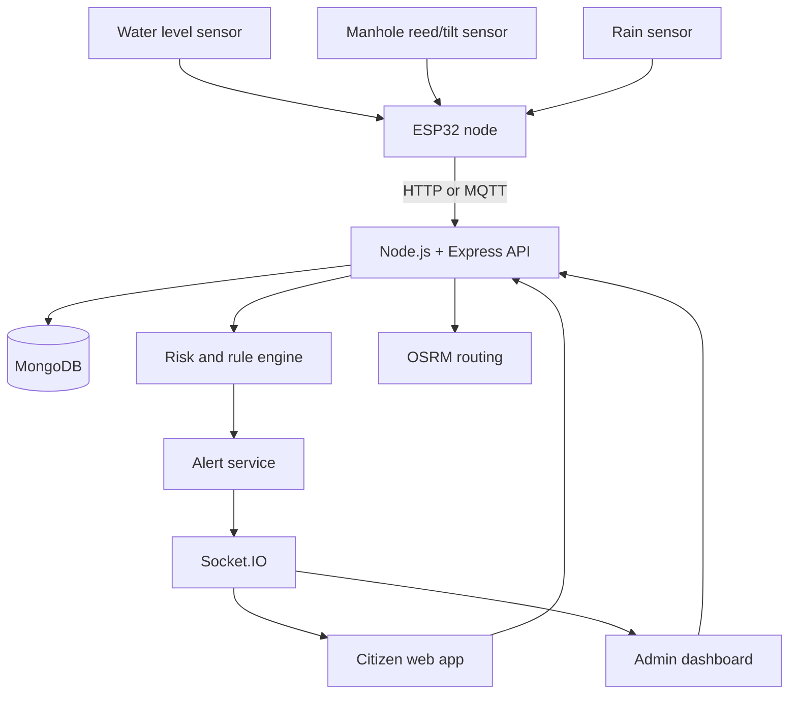
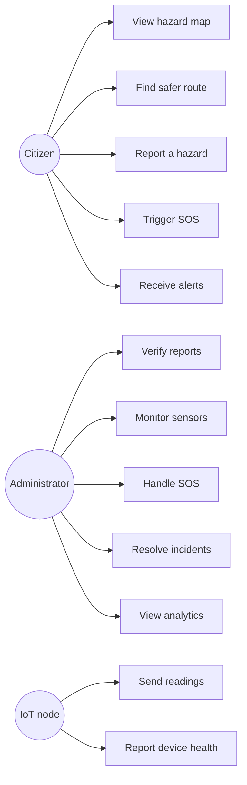
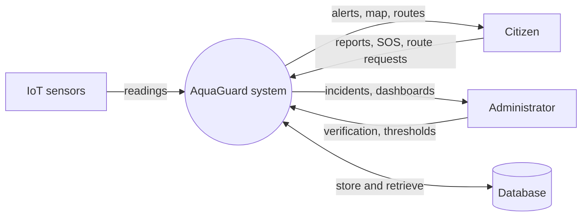
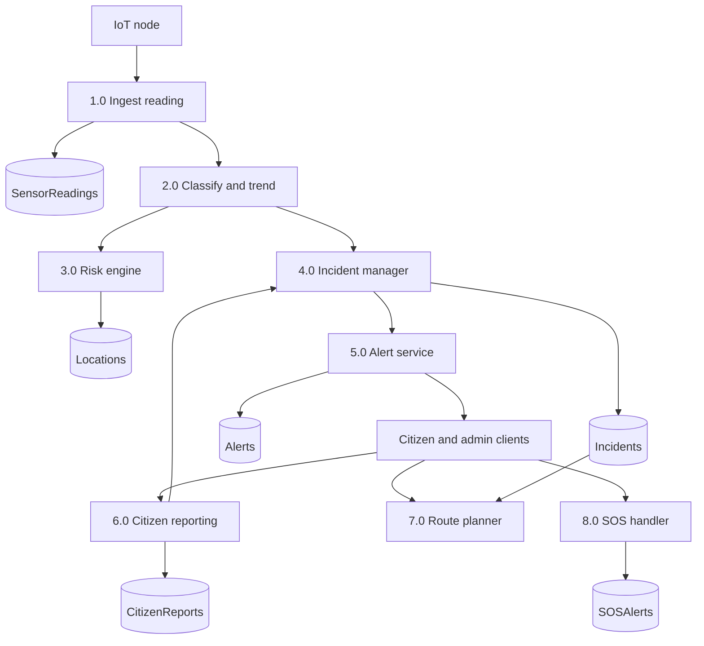
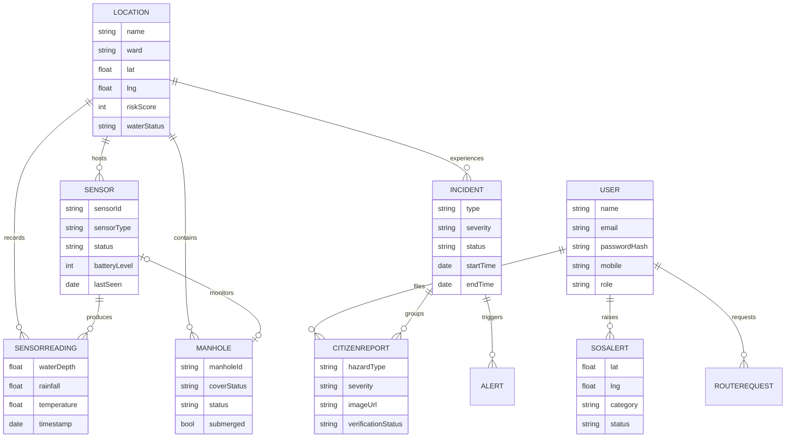
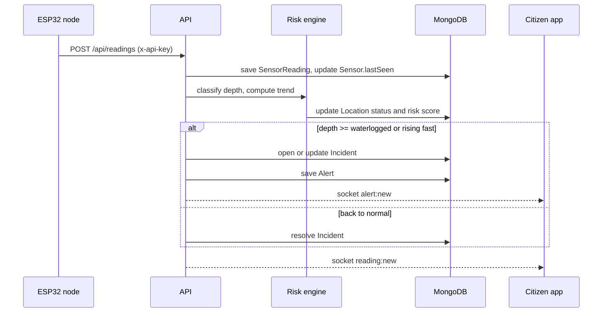
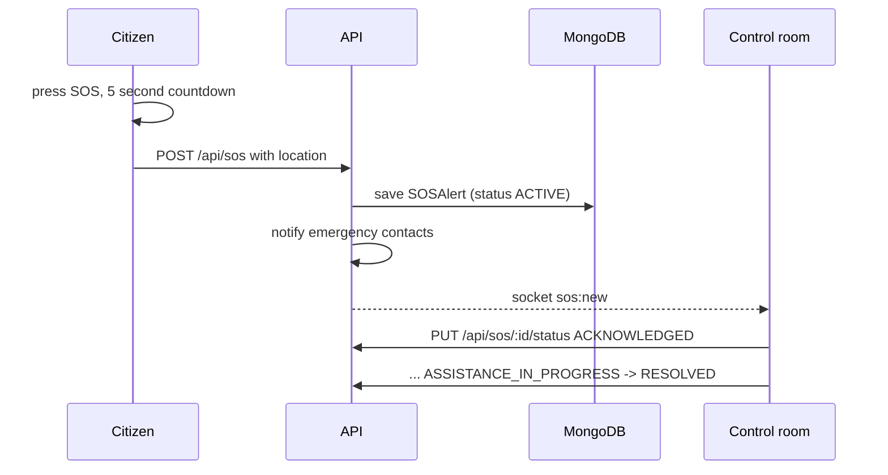
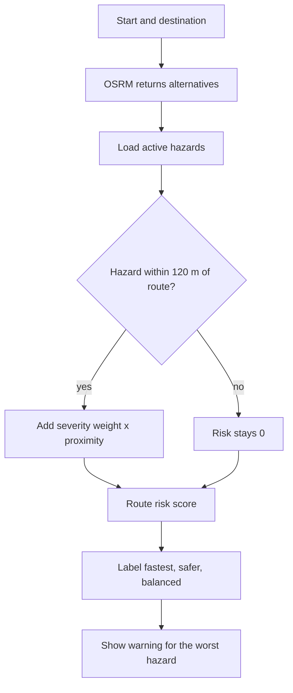

# Diagrams

Paste these Mermaid blocks into draw.io, Mermaid Live Editor (mermaid.live) or a
Markdown viewer, export as PNG, and drop them into the report.

## System architecture

## Use case

## Data flow, level 0

## Data flow, level 1

## Entity relationship

## Sequence: reading to alert

## Sequence: SOS

## Smart route decision

